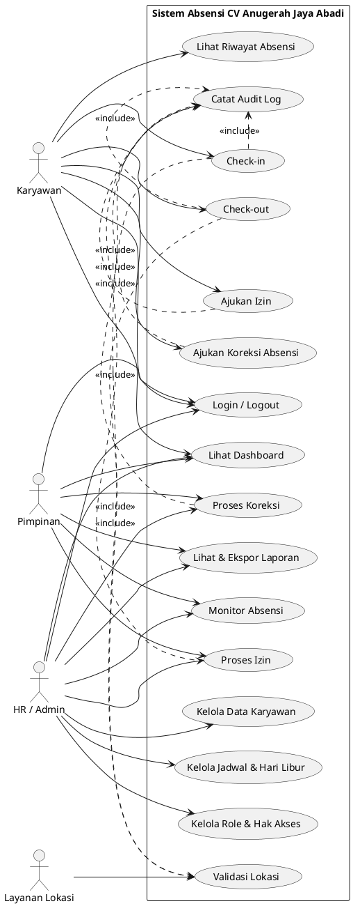
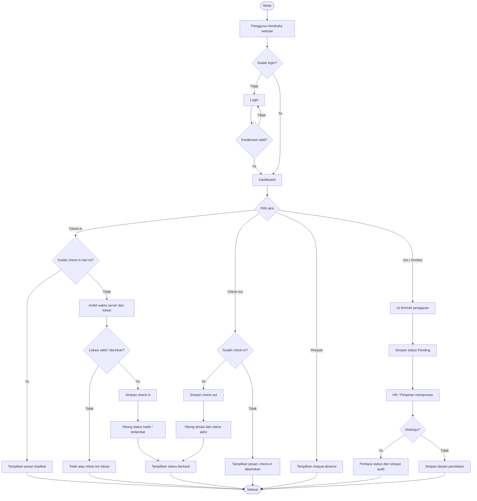
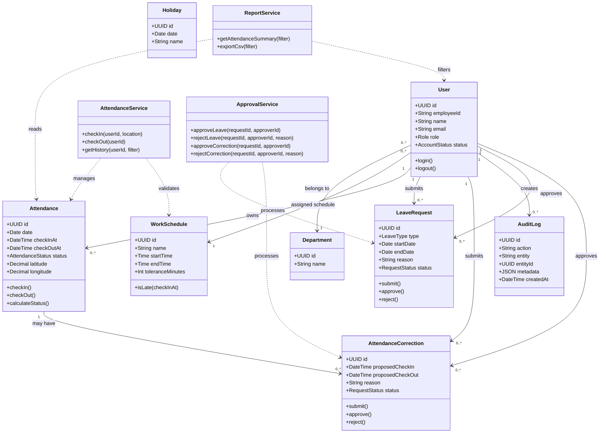

# PRD Website Absensi CV Anugerah Jaya Abadi

Versi: 1.0  
Tanggal: 10 Oktober 2026  
Status: Draft untuk validasi stakeholder

## 1. Ringkasan

Website Absensi CV Anugerah Jaya Abadi adalah aplikasi berbasis web untuk mencatat kehadiran karyawan secara terpusat, mengurangi pencatatan manual, dan menyediakan rekap yang dapat digunakan oleh HR/pimpinan.

Dokumen ini dibuat berdasarkan asumsi MVP karena folder proyek belum berisi requirement tertulis. Asumsi utama: absensi dilakukan melalui check-in/check-out, lokasi dapat dicatat, admin/HR mengelola data, dan karyawan dapat mengajukan koreksi absensi atau izin.

## 2. Tujuan Produk

- Mempercepat proses pencatatan kehadiran harian.
- Menyediakan data kehadiran yang konsisten dan mudah ditelusuri.
- Membantu HR membuat rekap harian, bulanan, dan per karyawan.
- Mengurangi manipulasi atau duplikasi pencatatan absensi.
- Menyediakan alur persetujuan untuk izin dan koreksi data.

## 3. Sasaran Pengguna

| Aktor | Kebutuhan utama |
|---|---|
| Karyawan | Login, check-in, check-out, melihat riwayat, mengajukan izin/koreksi |
| Admin/HR | Mengelola karyawan, jam kerja, absensi, izin, dan laporan |
| Pimpinan | Melihat ringkasan kehadiran dan menyetujui permintaan tertentu |

## 4. Ruang Lingkup MVP

### Termasuk

1. Login dan logout berbasis role.
2. Dashboard sesuai role.
3. Check-in dan check-out.
4. Penyimpanan waktu server dan lokasi perangkat bila diizinkan.
5. Validasi satu check-in dan satu check-out per hari.
6. Riwayat absensi pribadi.
7. Pengajuan izin dan koreksi absensi.
8. Persetujuan atau penolakan oleh HR/pimpinan.
9. Pengelolaan data karyawan.
10. Pengaturan jam kerja dan toleransi keterlambatan.
11. Rekap dan ekspor laporan CSV/Excel.

### Tidak termasuk MVP

- Integrasi mesin fingerprint/face recognition.
- Penggajian otomatis.
- Aplikasi mobile native.
- Multi-cabang dengan aturan berbeda.
- Perhitungan lembur yang kompleks.

## 5. User Story Utama

- Sebagai karyawan, saya ingin check-in dari halaman dashboard agar kehadiran saya tercatat tanpa formulir manual.
- Sebagai karyawan, saya ingin melihat status hadir, terlambat, atau pulang agar saya dapat memastikan data saya benar.
- Sebagai karyawan, saya ingin mengajukan koreksi jika lupa check-in/check-out.
- Sebagai HR, saya ingin melihat daftar absensi berdasarkan tanggal dan departemen.
- Sebagai HR, saya ingin menyetujui atau menolak izin dan koreksi dengan alasan yang tercatat.
- Sebagai pimpinan, saya ingin melihat ringkasan tingkat kehadiran untuk memantau kedisiplinan.
- Sebagai admin, saya ingin mengelola akun dan jam kerja agar sistem sesuai kebijakan perusahaan.

## 6. Persyaratan Fungsional

| ID | Persyaratan | Prioritas |
|---|---|---|
| FR-01 | Sistem menyediakan login, logout, dan reset password. | Must |
| FR-02 | Sistem membatasi menu berdasarkan role: karyawan, HR/admin, pimpinan. | Must |
| FR-03 | Karyawan dapat melakukan check-in jika belum check-in pada hari berjalan. | Must |
| FR-04 | Karyawan dapat melakukan check-out setelah check-in. | Must |
| FR-05 | Sistem mencatat timestamp dari server, bukan hanya waktu perangkat. | Must |
| FR-06 | Sistem dapat menyimpan latitude/longitude dan akurasi lokasi jika izin lokasi diberikan. | Should |
| FR-07 | Sistem menentukan status hadir, terlambat, pulang cepat, atau tidak lengkap. | Must |
| FR-08 | Karyawan dapat melihat riwayat dan detail absensinya. | Must |
| FR-09 | Karyawan dapat mengajukan izin dengan jenis, tanggal, alasan, dan lampiran opsional. | Must |
| FR-10 | Karyawan dapat mengajukan koreksi absensi dengan alasan dan waktu yang diusulkan. | Must |
| FR-11 | HR/pimpinan dapat menyetujui atau menolak pengajuan. | Must |
| FR-12 | HR dapat CRUD data karyawan, departemen, jadwal kerja, dan hari libur. | Must |
| FR-13 | HR dapat memfilter laporan berdasarkan tanggal, karyawan, departemen, dan status. | Must |
| FR-14 | Sistem menyediakan ekspor laporan CSV/Excel. | Should |
| FR-15 | Semua perubahan penting dicatat dalam audit log. | Should |

## 7. Aturan Bisnis

- Satu karyawan hanya dapat memiliki satu record absensi per tanggal kerja.
- Check-in kedua pada hari yang sama ditolak atau ditandai sebagai percobaan duplikat.
- Check-out hanya dapat dilakukan setelah check-in berhasil.
- Waktu absensi menggunakan zona waktu Asia/Jakarta dan timestamp server.
- Status terlambat dihitung berdasarkan jam mulai kerja ditambah toleransi keterlambatan.
- Hari libur dan hari non-kerja tidak dihitung sebagai mangkir.
- Pengajuan izin/koreksi berstatus `pending` sampai diproses oleh pihak berwenang.
- Karyawan hanya dapat melihat data absensinya sendiri.
- HR dapat melihat dan mengubah data operasional sesuai hak akses.
- Data yang sudah disetujui tidak dihapus secara permanen; koreksi dilakukan melalui audit trail.

## 8. Persyaratan Non-Fungsional

- Keamanan: password di-hash, session/token aman, validasi input, dan otorisasi di server.
- Privasi: lokasi hanya dicatat untuk kebutuhan absensi dan hanya dapat diakses role berwenang.
- Kinerja: dashboard umum merespons maksimal 3 detik pada beban normal.
- Ketersediaan: sistem menampilkan pesan yang jelas ketika jaringan atau layanan lokasi tidak tersedia.
- Responsif: dapat digunakan pada desktop dan browser mobile.
- Auditabilitas: aksi login, absensi, persetujuan, perubahan master data, dan ekspor tercatat.
- Backup: database dibackup berkala sesuai kebijakan operasional perusahaan.

## 9. Alur Status Absensi

`Belum Absen` → `Hadir` atau `Terlambat` setelah check-in → `Selesai` setelah check-out.

Jika ada masalah, record dapat memiliki flag `Tidak Lengkap`, `Koreksi Pending`, atau `Izin Disetujui` tanpa menghapus histori awal.

## 10. Data Utama

| Entitas | Atribut inti |
|---|---|
| User | id, employee_id, name, email, password_hash, role, status |
| Department | id, name |
| WorkSchedule | id, name, start_time, end_time, tolerance_minutes |
| Attendance | id, employee_id, date, check_in_at, check_out_at, status, location, notes |
| LeaveRequest | id, employee_id, type, start_date, end_date, reason, attachment, status, approver |
| AttendanceCorrection | id, attendance_id, employee_id, proposed_time, reason, status, approver |
| Holiday | id, date, name |
| AuditLog | id, actor_id, action, entity, entity_id, metadata, created_at |

## 11. Kriteria Penerimaan MVP

- Pengguna dengan kredensial valid dapat login dan diarahkan ke dashboard sesuai role.
- Karyawan dapat check-in satu kali dan melihat timestamp yang tersimpan.
- Check-in duplikat ditolak dengan pesan yang informatif.
- Karyawan dapat check-out dan sistem menghitung status sesuai jadwal.
- HR dapat memfilter, melihat detail, dan mengekspor rekap absensi.
- Pengajuan izin/koreksi dapat dibuat, diproses, dan riwayat statusnya terlihat.
- Pengguna tidak dapat mengakses data atau aksi di luar role-nya.
- Perubahan penting dapat ditelusuri melalui audit log.

## 12. Indikator Keberhasilan

- Minimal 95% absensi harian tercatat tanpa koreksi manual.
- Waktu pembuatan rekap bulanan HR berkurang dibanding proses spreadsheet/manual.
- Tidak ada duplikasi record absensi untuk karyawan dan tanggal yang sama.
- Mayoritas pengguna berhasil melakukan check-in dalam satu percobaan.

## 13. Rekomendasi Tahapan Implementasi

1. Validasi kebijakan jam kerja, role, lokasi, dan alur persetujuan dengan stakeholder.
2. Bangun autentikasi, master data karyawan, dan absensi inti.
3. Tambahkan izin, koreksi, audit log, dan laporan.
4. Uji penerimaan dengan data dummy dan skenario hari kerja/libur.
5. Pilot pada sebagian karyawan, lalu evaluasi sebelum peluncuran penuh.

## 14. Pertanyaan yang Perlu Diputuskan

- Apakah absensi wajib menggunakan geofence kantor? Jika ya, berapa radiusnya?
- Apakah foto selfie diperlukan saat check-in/check-out?
- Siapa yang menjadi approver: HR, pimpinan langsung, atau keduanya?
- Apakah satu karyawan dapat memiliki lebih dari satu jadwal kerja?
- Apakah laporan perlu format khusus untuk payroll?
- Apakah sistem perlu mendukung beberapa lokasi/cabang?

---

# Use Case Diagram

Diagram berikut memakai PlantUML. Dapat dirender di PlantUML, Kroki, atau plugin Markdown yang mendukung PlantUML.

---

# Flowchart Proses Absensi Harian

---

# Class Diagram

## Catatan Implementasi

Diagram class di atas memisahkan entitas data dari service aplikasi. Implementasi aktual dapat menambahkan repository, controller/API, DTO, validator, dan notification service sesuai stack teknologi yang dipilih.
