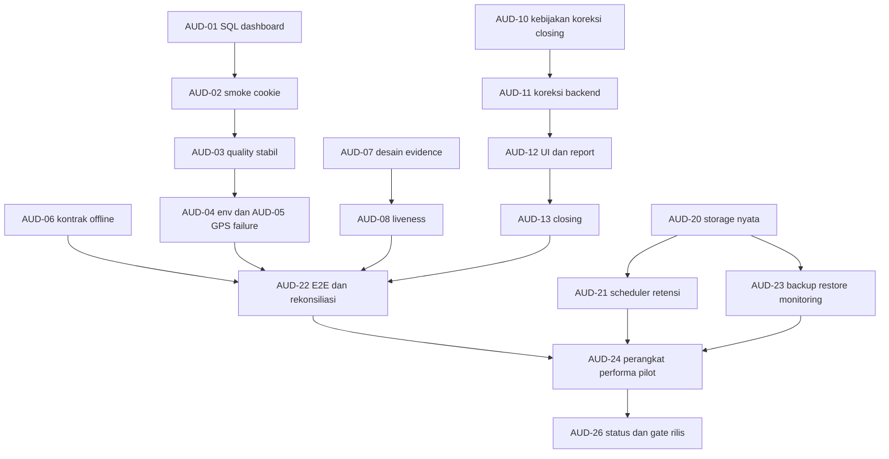

# Breakdown task tindak lanjut audit

Tanggal baseline: 14 Oktober 2026. Semua task di sini berstatus **TODO**, bukan pekerjaan yang telah dilaksanakan oleh audit. Estimasi adalah jam kerja engineering/review aktif untuk satu task, bukan janji durasi kalender; menunggu keputusan, akun, perangkat atau provisioning tidak dihitung. Tinjau ulang setelah desain/integrasi diketahui.

P0 menghalangi alur inti atau gate pilot; P1 menutup kebutuhan operasi; P2 penguatan/pemeliharaan. Prioritas ini milik audit, bukan penggantian label pada backlog asal.

## Urutan dan dependencies

AUD-09/14/15/16/17/18/19/25 dapat disiapkan sesuai dependencies pada masing-masing task. Diagram hanya menggambar rantai utama, bukan seluruh dependensi. Kerjakan satu task per run Luna agar konteks dan bukti selesai tetap jelas.

## AUD-01 — Perbaiki SQL dashboard employee

- **P0 · Backend · 2–4 jam · Dependency: tidak ada · Temuan F-01 · Asal BE-024/FE-011/INT-005.**
- Baca `apps/api/src/modules/dashboard/prisma-repository.ts`, routes dashboard, tes dashboard repository, dan `test/postgres-smoke.ts`.
- Konsistenkan alias `employee` pada filter CTE. Pertahankan employeeId + accountId dari server, tidak menerima identitas client.
- Tambah regression yang menjalankan query PostgreSQL pada database CI terisolasi, serta fixture A/B agar scope data benar-benar dibuktikan. Ubah expectation mock yang mengunci alias salah.
- **Acceptance:** query asli tidak lagi `42P01`; endpoint employee berhasil dan tidak mengembalikan data B; jadwal/riwayat/request tetap sesuai scope.

## AUD-02 — Perbaiki verifier cookie pada PostgreSQL smoke

- **P0 · QA/Backend · 2–4 jam · Dependency: AUD-01 · Temuan F-02 · Asal INT-005/DEP-004.**
- Target `apps/api/test/postgres-smoke.ts` dan signer `@fastify/cookie` yang terpasang. Baca auth route sebagai perilaku acuan.
- Ganti asumsi prefix/offset token dengan verifikasi signature library. Pertahankan checks HttpOnly/SameSite/Path dan penolakan token palsu; tambahkan case cookie tampered.
- **Acceptance:** signed cookie valid diterima, tampered ditolak, seluruh smoke selesai setelah migrasi fresh pada DB CI. Jangan mengubah signed cookie runtime atau melewati check hanya agar tes hijau.

## AUD-03 — Stabilkan quality command tanpa menyembunyikan timeout

- **P1 · QA · 2–4 jam · Dependency: AUD-02 · Temuan F-03 · Asal INT-004/DEP-004.**
- Target Vitest API/web, scripts root dan tes XLSX. Bandingkan default vs worker terbatas dan biaya import ExcelJS.
- Tetapkan worker budget yang beralasan untuk local/CI; pertahankan satu proses suite dengan isolasi yang dibutuhkan. Hindari menaikkan semua timeout atau skip assertion.
- **Acceptance:** `pnpm check` default dan tes XLSX terfokus lulus; bukti konfigurasi, runtime dan batas resource dicatat. Ulangi hanya secukupnya untuk mengevaluasi flake.

## AUD-04 — Regression root .env dan pembaruan startup docs

- **P1 · Backend/docs · 2–4 jam · Dependency: AUD-03 · Temuan F-15 · Asal BE-002/DEP-001.**
- Target `apps/api/src/config/env.ts`, `prisma.config.ts`, README dan env tests. Pertahankan perubahan lokal pengguna ke `../../../../.env`.
- Uji path source/build, shell env precedence, optional empty values, dan validasi staging/production dengan data sintetis. Jangan membaca/mencetak rahasia `.env` pengguna.
- **Acceptance:** start source dan output build memuat file root yang benar; shell menang; README menyebut persyaratan staging terbaru. Audit/fix tidak mengubah file rahasia pengguna.

## AUD-05 — Persist attempt ketika GPS tidak memperoleh fix

- **P0 · Backend/frontend · 8–16 jam · Dependency: AUD-01 · Temuan F-05 · Asal BE-013/14, FE-007/08, INT-001/006.**
- Target schema attempt/evidence, camera dialog, location capture, routes, API/OpenAPI dan migration jika nullability perlu berubah.
- Siapkan kontrak GPS failure: denied, timeout, unavailable, best-fix yang mungkin null. Pastikan PRD fallback dipenuhi dengan server pending; jangan memalsukan koordinat atau menetapkan Valid.
- **Acceptance:** selfie tanpa fix tetap menghasilkan receipt attempt pending dengan alasan; fix buruk tetap dipertahankan; online/offline error/retry tidak menggandakan attempt; authorization dan batas payload tetap terjaga.

## AUD-06 — Putuskan dan terapkan atribusi offline lintas tanggal

- **P0 · Product/backend · 12–24 jam setelah keputusan · Dependency: AUD-05 dan keputusan waktu/shift · Temuan F-06 · Asal BE-018/020, FE-009.**
- Baca `offline-sync.ts`, attendance/daily repositories, time service, antrean dan DECISIONS BE-018.
- Pertama tulis decision record: bukti waktu server sebelum offline, capture timestamp sebagai klaim, atribusi shift, cutoff, delay normal vs clock drift, serta late sync. Minta keputusan produk hanya untuk aturan bisnis yang belum terkunci; bagian verifikasi/source analysis tetap diselesaikan dahulu.
- Setelah keputusan, implementasikan kontrak dan rekonsiliasi exact-key yang sesuai. Pertahankan receipt timestamp immutable dan audit trace.
- **Acceptance:** check-in D sync D+1, shift malam, checkout, drift, >24 jam, daily ABSENT dan correction/closed period memiliki hasil eksplisit dan dites pada PostgreSQL. Jangan menjadikan waktu browser otoritas.

## AUD-07 — Desain bukti liveness yang dapat diverifikasi

- **P0 · Backend/security · 4–8 jam · Dependency: tidak ada · Temuan F-04 · Asal FE-006/BE-015/018.**
- Target liveness controller, selfie upload/sealing, attempt contract dan consent/privacy.
- Hasil task ini adalah decision record dan kontrak teknis: detector kemampuan nyata, challenge/randomness, bukti camera-origin, server verification, TTL, replay, privacy/retention, browser unsupported dan biaya/performa.
- Bedakan detector client dengan bukti tepercaya server; browser saja tidak membuktikan selfie mustahil dipalsukan. Hindari janji jaminan anti-spoof yang tidak terukur.
- **Acceptance:** desain dapat direview, fallback pending tetap berlaku, strategi pengujian spoof/replay jelas; tidak mengaktifkan Valid pada task desain.

## AUD-08 — Implementasikan liveness/verifier sesuai kontrak

- **P0 · Backend/frontend · 16–32 jam · Dependency: AUD-07 keputusan desain; AUD-20 untuk bukti provider · Temuan F-04 · Asal FE-006/BE-015/018.**
- Target detector adapter kamera, service proof, storage/verifier dan attendance repository.
- Implementasikan challenge/frame check dan jalur verifikasi server yang disepakati. Persist hasil tepercaya terpisah dari klaim client; jangan mengganti konstanta false menjadi flag request.
- **Acceptance:** spoofed flags, expired/replayed proof, wajah hilang, permission denied, unsupported dan trusted success diuji; hanya seluruh gate lulus dapat memberi Valid; tidak menyimpan frame/video mentah tanpa keputusan privacy.

## AUD-09 — Watermark pada gambar privat

- **P1 · Backend · 8–16 jam · Dependency: desain turunan gambar dan AUD-20 sebelum acceptance provider · Temuan F-07 · Asal BE-015/FE-005.**
- Target private selfie storage/upload dan metadata watermark.
- Buat gambar turunan dengan nama dari DB, receipt waktu server WIB dan koordinat yang memang tersedia; lokasi gagal memakai label eksplisit. Pertahankan original immutable/private dan referensi derivasi.
- **Acceptance:** pixel artifact diverifikasi, ukuran target sekitar 200 KB, signed read/scoping/retention berlaku pada kedua objek. Tidak menetapkan watermarkApplied sebelum proses berhasil.

## AUD-10 — Kunci kebijakan correction, closing dan override

- **P1 · Product/backend · 4–8 jam · Dependency: tidak ada · Temuan F-08 · Asal BE-022/026.**
- Siapkan decision table untuk correction tanpa original check-in, H+3 hari kerja, approver/scope, SLA, period/store/employee scope closing, pending data saat closing, alasan override, dan reopen vs append-only override.
- Tulis proposal berdasarkan PRD dan existing schema di DECISIONS; daftar keputusan terbuka terpisah. Dapatkan keputusan pemilik produk untuk perubahan/ambiguity bisnis sebelum dependent code.
- **Acceptance:** policy memiliki contoh input/output dan state transitions; original immutable, minimal dua Admin dan audit tetap terjaga. Output task desain tidak diklaim sebagai workflow selesai.

## AUD-11 — Workflow koreksi backend

- **P1 · Backend · 16–24 jam · Dependency: AUD-10 · Temuan F-08 · Asal BE-022/007/020.**
- Implementasikan service/routes/repository correction menggunakan record terpisah, actor session, scope toko, H+3, audit transaction dan lock employee yang sama dengan attendance/daily job.
- Perbarui OpenAPI/API serta migration hanya bila kontrak yang disepakati memerlukan.
- **Acceptance:** original tidak berubah; correction duplicate/unauthorized/out-of-deadline/closed ditolak sesuai policy; approve menyinkronkan daily status dan concurrent writes konsisten di PostgreSQL.

## AUD-12 — UI koreksi dan parity dashboard/report/XLSX

- **P1 · Frontend/backend · 12–24 jam · Dependency: AUD-11, AUD-01 · Temuan F-08/13 · Asal FE-012/013/016, BE-024/025.**
- Buat form employee dan review sesuai scope/approval yang disepakati. Hubungkan pesan check-in-required ke alur nyata.
- Gunakan source efektif correction yang sama untuk dashboard, rekap JSON dan XLSX; ganti `ignoreCorrections:true` hanya bersama semantics yang teruji.
- **Acceptance:** corrected attendance dapat dilacak ke original, UI memberikan alasan/SLA, report parity fixture correction lulus dan owner/closed guard berlaku.

## AUD-13 — Closing bulanan backend dan UI

- **P1 · Backend/frontend · 16–24 jam · Dependency: AUD-10/11/12 · Temuan F-08 · Asal BE-026/FE-016.**
- Implementasikan preview/close, idempotency, scope period, closed badge/export metadata, lock semua mutasi terdampak, dan Admin override beralasan sesuai policy.
- **Acceptance:** pending/late sync/job/correction concurrent terhadap closing tidak menembus lock; non-Admin read-only; audit before/after dan reason tersimpan atomik; reopening tidak muncul tanpa keputusan.

## AUD-14 — Stabilkan kebijakan request dan snapshot scope

- **P1 · Product/backend · 8–16 jam setelah keputusan · Dependency: keputusan approval/overlap · Temuan F-09 · Asal BE-021/024/025.**
- Putuskan overtime Supervisor vs Admin, overlap lintas tipe, request multi-store/global, serta scope historis saat assignment berubah.
- Implementasikan snapshot/context scope server yang disepakati beserta migrasi/backfill aman bila diperlukan; tetapkan retention/penghapusan surat dokter terpisah dari selfie.
- **Acceptance:** assignment berubah tidak membuka akses request lintas toko; overtime hanya dihitung menurut keputusan; race overlap/approval dan attachment authorization diuji PostgreSQL.

## AUD-15 — Saldo cuti dengan kebijakan eksplisit

- **P1 · Product/backend/frontend · 12–20 jam setelah keputusan · Dependency: AUD-14, keputusan kuota/akrual · Temuan F-10 · Asal FE-011/BE-021/024.**
- Putuskan kuota, accrual, carry-over, prorata, hari kerja/libur, pending reservation dan tahun efektif; jangan memakai default cuti hasil tebakan.
- Buat sumber balance/ledger resmi dan UI saldo; approval/reversal terhubung atomik.
- **Acceptance:** saldo opening/earned/used/reserved/remaining konsisten, concurrent request tidak overspend, scope employee enforced, perubahan beralasan diaudit.

## AUD-16 — Settings operasional terpusat dan audit perubahan

- **P1 · Backend/frontend · 12–24 jam · Dependency: keputusan keys/efektif berlaku; AUD-10/15 untuk rules terkait · Temuan F-10 · Asal BE-002/005/FE-014.**
- Petakan decision locks TODO ke satu provider settings, mencakup SLA, offline deadline, cutoff, correction window, retention, closing day dan konfigurasi per-store yang sudah ada.
- Bedakan config deployment dari Admin-editable policy; timezone tetap Asia/Jakarta. Tetapkan perubahan efektif dan snapshot histori sebelum membuat API/UI.
- **Acceptance:** batas tervalidasi, role Admin, audit reason/diff, histori tidak dihitung ulang diam-diam; UI dan service membaca sumber sama.

## AUD-17 — Alternatif GPS: QR, Wi-Fi, konfirmasi supervisor

- **P1 · Backend/frontend · 16–32 jam · Dependency: AUD-05/16 dan policy trust proxy · Temuan F-10 · Asal BE-019/FE-010.**
- Implementasi satu metode per increment: signed QR store-scoped TTL 30–60 detik/replay prevention, public IP Wi-Fi dari request terpercaya, kemudian supervisor confirmation dengan session/store scope.
- **Acceptance:** expired/replayed/store mismatch/forged header/unauthorized Supervisor gagal aman; bukti/metode tersimpan; semua alternatif gagal tetap menghasilkan pending attempt, bukan ABSENT.

## AUD-18 — Assisted attendance yang menjaga device binding

- **P1 · Backend/frontend · 12–24 jam · Dependency: AUD-05/07, policy bantuan perangkat · Temuan F-10 · Asal BE-010/013/FE-008.**
- Putuskan bagaimana akun sendiri dapat menggunakan perangkat toko/supervisor sementara tanpa mengganti approved device pribadi; pastikan bantuan tidak menjadi bypass sesi biasa.
- Implementasikan alur selfie bantuan, actor/context helper, limited session bila disepakati dan pending review.
- **Acceptance:** setiap record ASSISTED otomatis pending, employee identity dari server, authorization/expiry/helper audit jelas; perangkat pribadi tetap terikat sesuai FR-02.

## AUD-19 — Idempotensi disruption dan koreksi massal terkontrol

- **P1 · Backend/frontend · 12–24 jam · Dependency: AUD-10/11/13 dan keputusan mapping dampak · Temuan F-11 · Asal BE-023/FE-017.**
- Tambah durable request key/fingerprint bagi POST disruption, replay hasil sama dan conflict untuk payload berbeda.
- Siapkan preview impact, target status dan batch correction append-only sesuai policy; outcome uncertain dapat direkonsiliasi dengan key tanpa menebak dari pagination.
- **Acceptance:** retry tidak menggandakan record/audit, batch menghormati store/closed period, raw attendance utuh, hasil dan kegagalan batch dapat ditelusuri.

## AUD-20 — Buktikan storage privat pada staging yang diotorisasi

- **P0 gate rilis · DevOps/backend · 6–12 jam · Dependency: bucket/account/secrets disediakan atau provisioning diotorisasi · Temuan F-12 · Asal INT-003/011/DEP-002/005.**
- Siapkan executable validation/runbook lokal sebelum meminta persetujuan resource berbayar. Jangan memasukkan secret ke source/report.
- Verifikasi anonymous deny, signed PUT headers/CORS/expiry, signed read owner/Supervisor scope, staging→sealed copy immutability, deletion, encryption/ACL dan objek lampiran.
- **Acceptance:** provider evidence tersimpan dengan redaction, setiap assertion pass/fail eksplisit. Mock S3 tidak boleh dilabeli bukti bucket private.

## AUD-21 — Scheduler daily/retention, dry-run dan alert job

- **P0 gate rilis · DevOps/backend · 8–16 jam · Dependency: AUD-06/20, worker/cadence disetujui · Temuan F-12 · Asal BE-020/027/DEP-011.**
- Tambah dry-run retensi tanpa delete/write, scheduler dengan cadence yang memenuhi SLA/cutoff, mutual exclusion bila dibutuhkan, bounded retries, metric dan alert kegagalan.
- **Acceptance:** scheduled run dibuktikan, missed job alert bekerja, rerun idempotent, purge menjaga angka/audit/referensi; dry-run tidak memiliki side effect.

## AUD-22 — Integration/E2E dan rekonsiliasi sumber data nyata

- **P0 gate rilis · QA/backend/frontend · 16–32 jam · Dependency: AUD-01/02/05/06/08/12/13 untuk fitur terkait, AUD-20 untuk storage · Temuan F-13 · Asal INT-005/007/009/013/014.**
- Tulis matrix login→consent/password/device→attendance→review→correction→dashboard/report/export→closing. Jalankan HTTP/browser sesuai scope, SQL nyata dan private storage nyata untuk gate provider.
- Fixture wajib: A/B owner, Supervisor antar toko, multi-shift satu tanggal, libur, disruption, sync duplicate/unknown outcome, pending/approved/rejected dan concurrency.
- **Acceptance:** business flow lengkap dan dashboard/JSON/XLSX parity terbukti; failure/restore behavior dicatat. Jika provider/perangkat tidak tersedia, task tetap PARTIAL dengan bukti lokal yang spesifik.

## AUD-23 — Staging, monitoring, backup dan restore drill

- **P0 gate rilis · DevOps · 16–32 jam · Dependency: infrastructure owner/authorization, AUD-20/21 · Temuan F-12 · Asal BE-027/DEP-002–010.**
- Validasi App Spec dan build/run/routing/readiness gate; provision hanya bila sudah diotorisasi. Siapkan secrets, DNS/TLS dan private connectivity terpisah staging/production.
- Backup terenkripsi harian 30 hari, mingguan 3 bulan, offsite; observability tanpa selfie/GPS/secret; restore ke target terisolasi dan ukur RPO/RTO.
- **Acceptance:** restore data dan object references konsisten, RPO <=24 jam/RTO <=4 jam, alert terkirim pada failure uji, rollback runbook terbukti; deployment template saja tidak cukup.

## AUD-24 — Matrix perangkat, performa, pilot dan handover

- **P0 untuk pilot penuh · QA/operasional · 16–32 jam aktif · Dependency: AUD-21/22/23, perangkat/pilot tersedia · Temuan F-13 · Asal INT-008/012, DEP-012–015.**
- Uji Chrome Android 9+ dan Safari iOS 15+, install PWA, camera/GPS permission, indoor/outdoor, offline/reload/suspend, storage/quota, device replacement dan assisted.
- Load fixture 200 employee/20 store, ukur halaman <=3 detik dan attendance <=10 detik pada jaringan 4G acuan, payload <=300 KB. Jangan menyamakan gzip bundle dengan latency.
- **Acceptance:** matrix pass/fail beserta device/network, blockers ditutup, koordinat/radius toko disurvei, dua Admin aktif, reviewer SLA dan incident owner ditetapkan; training/runbook diserahkan.

## AUD-25 — Remediasi advisory uuid dengan compatibility evidence

- **P2 · Backend · 3–6 jam · Dependency: AUD-03 · Temuan F-14 · Asal DEP-004/security.**
- Baca `dependency-audit.json`, dependency path ExcelJS dan API UUID yang dipakai dependency; periksa reachability v3/v5/v6 dengan buffer.
- Pilih update upstream/override yang benar-benar kompatibel atau risk record owner/tenggat jika patch tidak aman. Jangan force major override tanpa bukti.
- **Acceptance:** advisory hilang pada fresh audit dan round-trip XLSX lulus, atau risiko terukur/disepakati secara eksplisit; lockfile reproduksibel dan audit high-level tetap berjalan.

## AUD-26 — Sinkronkan laporan status, backlog dan release gate

- **P2 · Docs/QA · 3–6 jam · Dependency: bukti task yang benar-benar selesai · Temuan F-15 · Asal docs/DEP-006/014/015.**
- Perbarui README/docs index/TODO status terbaru tanpa menghapus checkpoint historis. Link bukti per-task dan bedakan local, PostgreSQL, browser, device, provider dan production.
- Sediakan go-live checklist, owner blockers, release/rollback evidence dan decision log termasuk pilihan 2FA Admin sebelum produksi.
- **Acceptance:** tidak ada klaim COMPLETE bila workflow atau verification gate belum tersedia; task yang masih menunggu keputusan diberi alasan/dependency; semua link dan commands valid.

## Definition of Done untuk setiap run

Perubahan terkecil yang memenuhi task, tes perilaku relevan, dokumen API/decision bila kontrak berubah, bukti command beserta exit/result, dan ringkasan risiko/batas verifikasi. `pnpm check` diperlukan setelah implementasi; uji DB/browser/provider tambahan sesuai task. Kegagalan harus dilaporkan dan diperbaiki jika berada dalam scope; jangan mengganti status gagal dengan klaim tes yang lebih kecil lulus.

Jika task mengandung keputusan belum final, selesaikan analisis, proposal dan kriteria penerimaan terlebih dahulu. Persetujuan diperlukan hanya untuk aturan bisnis yang belum disepakati atau aksi eksternal berbayar/destruktif di luar otorisasi; pemeriksaan dan artefak lokal tetap dikerjakan.
